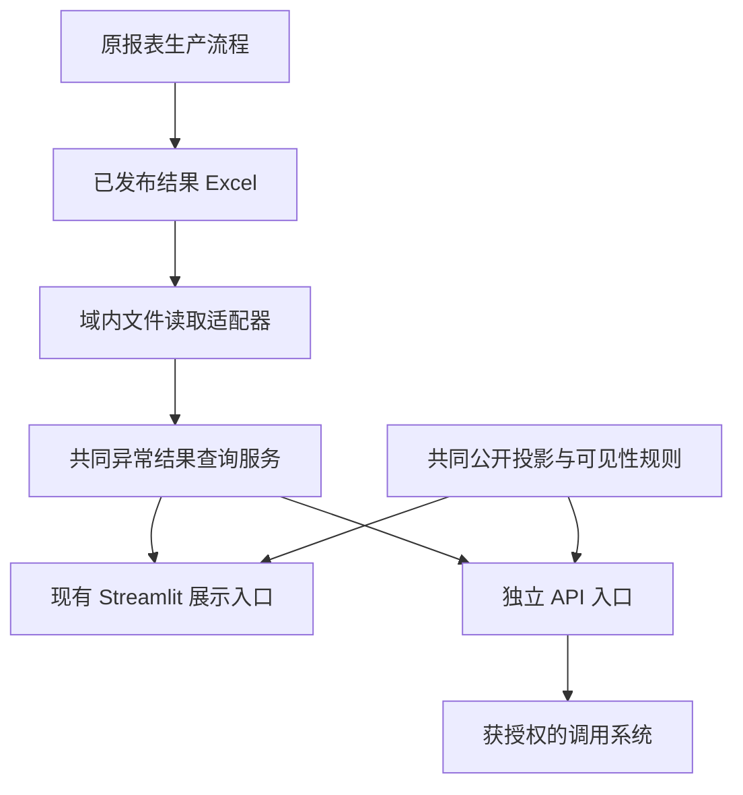

# 异常片明细 API 开发方案

编写与源码核验日期：2026-10-27。

状态：供讨论的开发建议，尚未实施。本文依据当前工作区源码和文档作静态分析，未查询数据库、读取生产工作簿或验证线上数据。基础概念见 [API 入门说明](sheet-anomaly-api-primer.md)。

## 1. 结论与建议范围

**可以基于现有自动预警看板的逻辑开发，建议复用已发布结果的读取与筛选，再增加独立 HTTP 入口。** 不需要先建设新的异常识别系统，也不需要向调用方开放数据库。

建议首版采用 FastAPI，在公司内网提供只读 JSON 接口。原报表继续负责生产和发布结果，API 仅消费结果；缺文件、缓存未命中或读取失败均不触发原始分析。

本文将用户的“仅限单片异常”暂按**严格逐片**理解。这是方案假设，尚待业务确认；如果实际指页面现有“单片异常”分组，则范围需要扩大到部分 Lot 记录。

| 看板指标 | 已核验的记录粒度 | 严格逐片首版建议 |
|---|---|---|
| SPC 单片异常 | `sheet_id`、站点、参数 | 纳入 |
| CTQ 单片异常 | `sheet_id`、站点、参数 | 纳入 |
| AOI_TT 单片异常 | `sheet_id`、站点、TT 名称 | 纳入 |
| AOI_RS 单片异常 | `chart_kind=sheet/lot`；`point_id` 分别对应片号或 Lot 号 | 仅纳入 `chart_kind=sheet` |
| Yield 单片异常（Lot 超规） | Lot、异常 Code | 待确认；不属于严格逐片 |
| Q-Time 单片异常 | `lot_id`、站点区间 | 待确认；现有发布明细没有逐片归属 |

不纳入 CPK／CPM 趋势、Yield 趋势、AOI 密度趋势、IJP、关键备件和 IQC。首版也不提供图像、原始量测点、异常决策修改、强制刷新或任意历史区间查询。

AOI_RS 严格逐片结果是现有预警表的 By Sheet 子集，因此不能承诺条数等于矩阵整行条数。Yield、Q-Time 如需后续接入，可保留 Lot 粒度并明确 `entity_type=lot`，不把 Lot 号填进 `sheet_id`，也不把整个 Lot 展开为“每片都异常”。

## 2. 当前可以复用什么

当前主链路：

```text
原报表处理与异常判定 → 发布结果 Excel
                              ↓
                  read_alert_result() 共同读取／筛选
                         ↙                 ↘
                   报表预警表         矩阵状态和详情
```

| 现有位置 | 已核验的职责 | 对 API 的意义 |
|---|---|---|
| [自动预警看板.py](../../../../../app/pages/自动预警看板.py) | Streamlit 初始化、交互和矩阵入口 | 用于追踪行为，不直接作为接口模块导入 |
| [alert_results.py](../../../../../app/sections/shared/alert_results.py) | 文件签名、公共筛选入口、结果与展示表、`st.cache_data` | 主要复用来源；需拆出不依赖 Streamlit 的服务 |
| [excel_alarm_reader.py](../../../../../src/inline_domain/application/monitor/excel_alarm_reader.py) | 验证明细字段、产品归属、时间和标记，保留业务键 | 复用校验及读取契约 |
| [excel_alarm_store.py](../../../../../src/inline_domain/infrastructure/monitor/excel_alarm_store.py) | 整本 Excel 解析、文件版本缓存、日期排除 | 复用文件适配；缓存与读取需解除 Streamlit 耦合 |
| [sheet_oos_alerts.py](../../../../../src/inline_domain/core/shared/sheet_oos_alerts.py) | 上一完整周及现有 OOS 选择规则 | 直接复用纯函数，不复制另一套异常算法 |
| [composition.py](../../../../../src/inline_domain/composition.py) | 组装读取器及具体适配器 | 新接口沿用组合入口和资源解析机制 |
| [compliance_manager.py](../../../../../app/manager/compliance_manager.py) | 矩阵公开显示策略，状态与详情联动 | 必须复用语义；只用共同读取器仍不足以形成对外结果 |

四类 Inline 读取产品同名 sheet。SPC／CTQ 使用 `sheet_start_time`、`sheet_id`、`param_name`；TT 使用 `start_time`、`sheet_id`、`tt_name`；RS 使用 `sheet_start_time`、`point_id`、`rs_code`、`chart_kind`。

现有后端的选择条件包含 `flag=False`、上一完整 ISO 周及现行日期／参数政策；SPC 还应用配置中的参数名排除，TT 排除误归类的 PPA 参数。这里的 `flag` 是内部决策字段，不是“所有超出规格的原始量测”的同义词。API 复用现有有效预警，不重新对数值判定一次，也不公开这些内部字段。

权威规则仍由 [看板架构](../../../../../references/domain/inline_domain/monitor/architecture-alert-dashboard.md)、[共同展示设计](../../../../../references/design/inline_domain/shared/architecture-published-alert-display.md)、[Inline 日期排除](../../../../../references/domain/inline_domain/shared/rules-inline-date-exclusion.md) 和 [ADR-0036](../../../../../docs/ADR/0036-shared-published-alert-display.md) 维护，本文不是规则替代件。

## 3. 推荐结构与最小改造



### 3.1 把可复用逻辑放到合适的位置

建议新增位置如下，**这些是拟议路径，当前尚不存在相应实现**：

| 拟议位置 | 职责 |
|---|---|
| `api/main.py` | 独立 FastAPI 应用、生命周期与路由装配 |
| `api/routes/sheet_anomalies.py` | 身份校验、查询参数、状态码和分页协议 |
| `api/schemas/sheet_anomalies.py` | 严格的公开请求／响应模型 |
| `src/inline_domain/application/monitor/sheet_alert_query.py` | 从现有 `_read_inline()` 提取域内读取和预警选择，返回结构化可用性与记录 |
| 现有 Inline `composition.py` | 注入读取端口、资源位置、规则和缓存适配器 |

具体做法：让原 `app/sections/shared/alert_results.py` 的 Inline 分支与 API 调用同一个应用服务。保留原页面的 `read_alert_result()` 和缓存包装，对页面及其他域消费者保持兼容。应用服务通过现有 `ExcelAlarmStorePort` 或其最小扩展消费适配器；不能从 `src/` 反向导入 `app/`。

工作簿解析也要拆出普通 Python 读取函数。Streamlit 可以保留原缓存包装，API 使用独立、有上限的缓存；两者共用解析实现与验证规则，不依赖 `session_state`，不通过伪造页面运行环境调用接口。

指标／产品 revision 当前通过 `app/components/indicator_cache.py` 获取，也是需要解除的上层依赖。应提取中立的版本读取机制或通过端口注入，保留现有 revision 文件位置、格式和原子更新语义；API 不能为读取版本而在 `src/` 导入页面组件，也不提供推进 revision 的 HTTP 操作。

公开可见性规则目前放在 `app/manager/compliance_manager.py`，需要把纯判断和只读配置加载提取为两个入口都可使用的中立组件。通用机制可归 `shared_kernel`，但不得导入具体业务域；指标键与显示名称的绑定由上层组合注入。保留现有页面兼容包装，不移动或重写维护工作簿。

这些调整扩展了现有共同展示边界，实际实施时应更新 `ARCHITECTURE.md` 及相关设计／ADR。当前仅交付建议，不提前把拟议结构写成现行架构。

### 3.2 对外公开口径是上线前置条件

API 必须遵守项目的 [非管理员展示边界](../../../../../CONTEXT.md#non-administrator-presentation-boundary)。凭证校验成功，也不意味着允许获取另一版本的数据。

处理顺序建议为：

1. 识别调用方，检查产品／厂别／指标权限。
2. 校验并应用公开可见性政策；政策配置无法可靠读取时关闭本次数据输出，返回安全的 `503`。
3. 读取本次允许公开的发布结果，应用现有有效预警规则和严格逐片子集。
4. 应用请求中的厂别／片号过滤，按公开字段白名单构建 DTO，再统计、排序和分页。
5. 序列化并返回，仅记录必要的服务端诊断信息。

被公开政策处理为无预警的指标／产品，不得通过明细、计数、原状态、错误原因、发布时间或下一页游标反推出被隐藏的记录。也不提供 `admin`、`raw`、绕过政策等请求参数。

不能直接返回 `read_alert_result()` 的 `records` 或整个返回字典；其中包含内部业务键或元数据。现有 `alerts` 是页面白名单，但 API 仍需自己明确允许字段、类型和可空项。

## 4. 建议的接口契约

本节全部为待实施契约。第一版先做“一个指标＋一个产品”，避免一次跨域请求的部分成功和模糊计数。

### 4.1 路径与参数

`GET /api/v1/sheet-anomalies`

| 参数 | 约束与建议 |
|---|---|
| `indicator` | 必填；`spc`、`ctq`、`aoi_tt`、`aoi_rs` |
| `product` | 必填；必须同时属于启用产品和调用方授权产品；返回产品代码，不附加界面注释 |
| `factory` | 可选；`ARRAY`、`OLED`、`TP`，只允许已授权范围 |
| `sheet_id` | 可选；精确匹配，限制长度；不把用户输入解释为正则或路径 |
| `limit` | 默认 100，范围 1～500；这些数值是初始建议，需要文件规模验证 |
| `cursor` | 下一页不透明游标；只能用于同身份范围、同条件、同公开结果快照 |

省略 `factory` 表示调用方获授权的全部厂别，与启用范围取交集；不能默认为全厂。显式越权请求返回 `403`，不静默扩大或混合范围。未知指标、非法日期式参数、超限 `limit` 等返回 `422`。未定义的控制参数也应拒绝。

首版不开放 `start_date`、`end_date` 或任意 `reference_date`，参考日取配置时区下的服务器当日，查询上一完整 ISO 周。以 2026-10-27 为例，区间为 **2026-10-19 00:00:00 至 2026-10-26 00:00:00，右端不包含**。

范围采用业务显示时间。已发布 Inline 明细已按显示时间存储，不再次偏移；日期排除继续由现有 infrastructure 输出适配执行。不因为增加 API 改变源快照、当日报表截止或原生产政策。

### 4.2 成功返回示例

下面均为虚构数据；域名、产品和片号只用于说明结构：

```json
{
  "data": [
    {
      "indicator": "spc",
      "product": "PRODUCT_DEMO",
      "factory": "ARRAY",
      "step_id": "STEP_DEMO",
      "sheet_id": "SHEET_DEMO_001",
      "parameter_name": "参数示例",
      "occurred_at": "2026-10-22T09:30:00+08:00",
      "details": {
        "oos_type": "USL"
      }
    }
  ],
  "meta": {
    "status": "alert",
    "period_start": "2026-10-19T00:00:00+08:00",
    "period_end_exclusive": "2026-10-26T00:00:00+08:00",
    "timezone": "Asia/Shanghai",
    "read_at": "2026-10-27T10:00:00+08:00",
    "published_at": null,
    "snapshot_id": "public_snapshot_demo",
    "returned_count": 1,
    "has_more": false,
    "next_cursor": null
  }
}
```

`read_at` 是本次读取时间；`published_at` 仅在存在可靠产品发布元数据且允许公开时填写，没有依据则为 `null`，不能用文件修改时间或读取时间冒充发布时间。可靠发布时间的提取需要服务契约补充：现有 reader 保留在 DataFrame attrs 中，当前共同结果并未保证向外传递。

建议首版不返回全量 `total`。`returned_count` 只表示本页异常**明细行数**；同一片多个站点／指标可以多行。如以后增加异常片数，必须另设去重指标并注明去重范围。

### 4.3 字段映射和数值

| 指标 | `sheet_id` | `parameter_name` | `occurred_at` | `details` 允许字段 |
|---|---|---|---|---|
| SPC／CTQ | `sheet_id` | `param_name` | `sheet_start_time` | `oos_type` |
| AOI_TT | `sheet_id` | `tt_name` | `start_time` | `tt_qty`、`usl` |
| AOI_RS | 仅 `chart_kind=sheet` 的 `point_id` | `rs_code` | `sheet_start_time` | `value`、`spec` |

`details` 应采用按指标区分的明确模型，不接受任意字典透传。RS 的 `value`、`spec` 语义沿用 By Sheet 发布结果；未核验单位前不擅自标成密度或百分比。SPC／CTQ 不因为后台存在 `sheet_max`、`sheet_min` 就自动增加数值输出。

片号、站点、产品均按字符串输出，保留前导零。时间输出带明确时区的 ISO 8601；当前无时区时间需要按实际报表时区解释，不能直接当 UTC。缺失可选值转为 JSON `null`，禁止输出 `NaN`／`Infinity`。必需身份键缺失或值不合法，应判定该结果不可用，不能编造片号或悄悄丢行。不得输出 `flag`、决策规则、配置路径、原始异常堆栈及未列出的内部字段。

### 4.4 无数据和失败

| 情况 | 建议响应 | 含义 |
|---|---|---|
| 有效来源，筛选后有公开明细 | `200`，`status=alert` | 有当前查询范围内的异常 |
| 有效来源，筛选后无公开明细 | `200`，`status=ok`，`data=[]` | 查询成功，无可提供的异常明细 |
| 缺结果文件／产品 sheet、文件损坏、schema 不合格 | `503` | 当前无法可靠提供结果 |
| 有明确有效期规则的来源已过期／覆盖不足 | `503` | 不把旧结果冒充本期结果 |
| 凭证缺失／失效 | `401` | 需检查凭证 |
| 显式请求超出授权 | `403` | 不能访问该范围 |
| 参数错误 | `422` | 修正请求后重试 |
| 超出频率或并发上限 | `429`，`Retry-After` | 等待后重试 |
| 游标过期、参考周或公开结果变化 | `410` | 从第一页重新读取 |
| 未预期程序故障 | `500` | 记录请求编号，返回统一安全消息 |

上述可用性在公开政策允许提供数据的前提下判断；政策不允许公开的单元格遵循同一公开无预警口径，不附加能暴露内部状态的元数据。

**这里有一项需要开发补齐的差异：** 当前 Inline 共同读取器会把缺文件／缺产品 sheet 归为 `no_data`，而有效空产品表归为 `ok`。API 不能靠 `alerts.empty` 判断是否成功；应在应用服务中增加结构化可用性原因，再由页面保留现行显示、API 映射为上表状态。不得把页面绿色等同于“数据已完整更新”。

四类 Inline OOS 结果目前也没有统一的“当日发布＋TTL”强制有效性协议。首版不得擅自套用 Q-Time／Yield 的有效期规则。应公开有依据的发布时间，说明“最后已发布结果”；如果调用方要求当日更新或确定覆盖，需先补充可靠发布／覆盖元数据和过期标准，再承诺对应 SLA。缓存 TTL 不是数据新鲜度承诺。

安全错误示例：

```json
{
  "error": {
    "code": "result_unavailable",
    "message": "当前预警结果暂不可用，请稍后重试。"
  },
  "request_id": "request_demo"
}
```

## 5. 分页、缓存和并发

建议用“固定公开结果快照＋游标”分页。生成快照前完成权限、公开政策、业务过滤与字段投影，再按时间倒序、片号、站点、参数及必要的公开字段作稳定排序。不要擅自用片号去重，原始数据中的重复事实问题按既有规则处理。

快照保存不可变的公开结果列表，游标定位列表位置，避免翻页期间文件重写导致漏行或重复。游标绑定调用方授权范围、指标、产品、厂别、片号、页大小、参考周和快照；服务端校验，不能只把用户可改的页码做 Base64。

首版可在单个 API 进程中保存有数量／内存上限的短期快照；建议先试 5 分钟有效期，最终按真实规模调整。进程重启、快照淘汰或结果变化时返回 `410`。继续翻页也必须重新检查凭证、授权和公开政策，不能继续返回已不允许公开的旧快照。

内部缓存键包含实际文件版本、日期／参数／分类政策、指标产品 revision、业务参考日和查询范围。公开响应快照还必须跟踪授权与公开政策变化。内部依赖变化但公开结果未变，不应通过对外版本暴露隐藏信息；`snapshot_id` 是公开结果的不可猜测标识，不输出路径、原始文件哈希或内部 revision。首版不增加 ETag，响应建议 `Cache-Control: no-store`，由客户端按约定重新查询。

现有 `get_compliance_file_signature()` 返回固定兼容值，并不能用于 API 公开策略失效；现有实现把显示政策放在计算缓存外应用。API 应继续每次按当前政策生成公开投影，或为公开投影建立真实政策版本，不让旧分页缓存绕过新政策。

首次 Excel 解析成本与文件整体大小有关，分页本身不能降低这项成本。开发前需通过文件大小、sheet 数及已有元数据评估规模，不读取数据库来测接口。为单文件解析设置并发锁，避免请求同时冷启动重复解析。暂不引入 Redis 或新数据库。

Excel／COM 是同步操作，不能仅通过 `async def` 变成非阻塞。应使用合适的同步执行边界、有限线程／任务并发及超时。HTTP 超时本身不会终止卡住的 Excel COM；若需要 COM，必须验证线程初始化、资源释放和可终止的执行边界。

## 6. 安全与部署建议

建议为每个调用系统分配独立凭证，绑定可读产品／厂别／指标；服务端保存安全的校验材料，支持撤销和轮换。项目启用产品仍由 `ConfigLoader.get_enabled_products()` 决定，最终范围是启用范围与调用方授权的交集。凭证通过环境变量或正式凭据设施配置，不写进 Git、业务 YAML 或普通文档。

服务部署建议：

```text
调用系统 → 公司内网 HTTPS 入口 → 独立 API 进程 → 配置指定的发布文件
                                  现有 Streamlit 服务独立运行
```

推荐技术是 FastAPI＋Uvicorn，增加依赖前做项目环境兼容验证并更新依赖锁。FastAPI 可生成接口模型与文档；HTTPS、自动启动、异常重启和进程数量仍需部署设计。[FastAPI 功能](https://fastapi.tiangolo.com/features/)、[部署概念](https://fastapi.tiangolo.com/deployment/concepts/)

首轮试点建议同主机、独立进程、单 worker，API 端口待分配，保留现有正式服务配置。对外通过正式 HTTPS 入口转发，限制访问网段。生产不使用开发热重载。多 worker 前先处理进程间分页快照路由、重复文件缓存与 COM 并发；不能假设多个进程共享缓存。

资源位置一律经现有全局资源注册和 ConfigLoader 解析，不在接口里硬编码 `resources/...` 文件名，也不允许调用方提交文件路径。服务账号仅获得所需目录读取权限和批准的日志／缓存写权限，不因为部署 API 增加生产数据库访问权限。

现有 Excel 适配器在普通读取失败后可能回退 Excel COM，因此“只读结果接口”不等于“完全不依赖 Office”。上线前必须验证企业保护文件在拟用账号、会话及并发下可读。如果后台账号不可读取，需评估由原生产流程原子发布可读投影、API 只读该投影的备选方案；不能以解密失败为由查询数据库补算，也不能未经确认改变原资源格式或保留策略。

限流初值可设每调用系统每分钟 60 次，并发／解析上限按实测配置，不能只靠限制返回条数。网关、应用和文件读取都需超时边界；限流与资源上限是服务保护机制。[OWASP 资源消耗风险及防护](https://api-security.owasp.org/editions/2023/en/0xa4-unrestricted-resource-consumption/)

提供不查询数据库的存活检查；就绪检查验证配置与必要读取依赖，数据接口另行反映具体产品结果可用性。对外健康信息不列出产品缺失、内部路径或异常堆栈。接口文档按授权范围开放；内网无法访问外部 CDN 时自托管交互文档静态资源。

日志记录请求编号、调用系统标识、范围、状态、耗时和返回条数，不记录密钥、整份异常片明细或原始请求头。运行日志归 `output/logs/`，重建缓存归 `output/cache/`，测试材料归 `output/test-results/` 或 `output/tmp/`。接口停机不影响原报表生产与 Streamlit 页面。

## 7. 开发步骤与验收

| 阶段 | 具体交付 | 验收依据 |
|---|---|---|
| 1. 明确契约 | 确认严格逐片范围、调用方、公开字段、周期和新鲜度要求 | 请求／响应示例可由双方直接核对 |
| 2. 提取共同服务 | Inline 查询服务、可用性分类、中立公开策略、Streamlit 兼容包装 | 原报表／矩阵行为保持；API 路径没有 UI 状态或生产副作用 |
| 3. 实现 HTTP 接口 | 模型、鉴权授权、查询、分页、缓存、错误和日志 | 使用临时工作簿的自动化契约测试通过 |
| 4. 部署验证 | 内网试点、服务账号、文件读取、限流和托管 | 正常读取、失败恢复、并发冷读、重启行为有证据 |
| 5. 调用方联调 | OpenAPI、调用示例、凭证领取说明、运行维护说明 | 对方能独立取完明细，并正确处理零条、失败和分页重启 |

开发验证至少覆盖：

- 周一、跨年 ISO 周及时间边界；明确验证 2026-10-19 包含、2026-10-26 不包含；显示时间不重复偏移。
- 四类字段映射、RS 仅 By Sheet、SPC 参数排除、TT 参数分类、日期排除和片号字符串保真。
- 同片多站点／参数保留多条，条数不冒充异常片数；可选值缺失转 `null`，无非法 JSON 数字。
- 缺文件、缺产品 sheet、有效空表、损坏、错误 schema 和缺失必需键；没有可靠发布信息时不编造新鲜度。
- 凭证缺失、失效、越权，以及未指定厂别时只返回授权厂别；禁用产品不出现在响应中。
- 公开策略作用于明细、计数、状态和版本；策略读取失败关闭输出；策略／授权中途改变后旧游标不能继续读取。
- 文件改写、策略变化、revision 和参考周变化后的失效；稳定分页、游标篡改、过期、淘汰与服务重启。
- 缓存未命中、来源缺失和失败时，禁止数据库调用、原报表计算、维护文件写入的替身断言；验证源文件字节未改。
- 临时文件的 API 契约测试及原页面相关回归，不为这些测试查询生产数据。

实施后的相关回归至少包含现有 `tests/unit/app/sections/monitor/test_shared_alert_results.py`、新增 HTTP 契约测试及 `tests/architecture/test_backend_dependencies.py`。先以 SPC 完成临时工作簿到 HTTP 的完整链路，再接入其余三类，有助于及早验证中立服务和公开投影边界。

优先用进程内 HTTP 测试客户端验证接口。若必须启动临时服务，启动前记录本次进程及子进程身份与端口，设置 `try/finally` 清理；覆盖正常、失败、中断，结束检查进程退出和监听释放，只停止本次创建的进程。清理机制验证使用不连接数据库的最小测试页，保留用户已确认的正式服务。

本轮只新增两份说明文档，不安装依赖、不改源码、不启动服务。文档检查不能证明 API 的运行性能或生产文件可读性。

## 8. 开发前需要确认的事项

| 待确认项 | 当前建议 | 改变后的影响 |
|---|---|---|
| “单片异常”指严格逐片，还是页面分组？ | 严格逐片四类；RS 仅 By Sheet | 页面分组需再纳入 Yield／Q-Time 等 Lot 语义与各域有效性 |
| 谁调用，能看哪些产品和厂别？ | 先选一个内部系统，独立凭证、最小范围 | 多调用方需分别授权、限流和撤销 |
| 是否只取上一完整周？ | 与矩阵时间范围一致 | 任意历史需验证发布文件保留与覆盖能力 |
| 能接受最后已发布结果，还是必须当天更新？ | 显式说明最后发布语义；没有依据不承诺实时 | 硬性新鲜度需先补齐发布／覆盖元数据和生产更新保障 |
| 是否需要测量值／规格？ | 按表中已有公开字段，SPC／CTQ 先提供身份与异常类型 | 增加字段需核验业务含义、单位和公开边界 |
| 服务放在哪里，何时可用？ | 内网固定主机、正式进程托管 | 持续高可用需独立运行主机及相应运维安排 |

以上均为进入实际开发前的业务与运行决策，不影响当前阅读和讨论方案。后续若确认“页面分组”口径，应调整接口资源名称与响应粒度，保留各域原有发布协议，而不是把 Lot 数据伪装成逐片结果。
