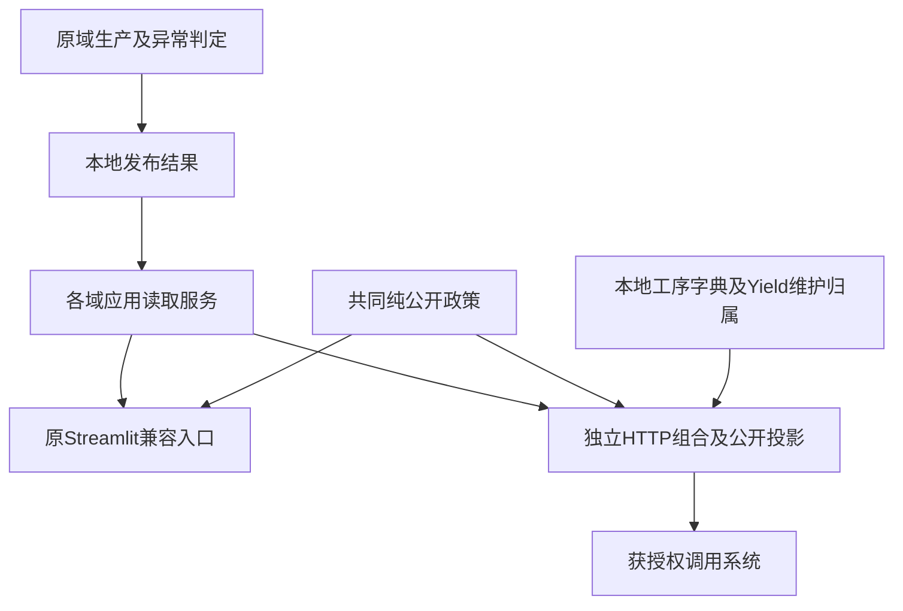

# 异常片／Lot API 开发方案与实施状态

初版：2026-10-27。需求修订及实现核验：2026-11-02。

状态：**实现、专项验证及评审已完成，保留基线失败质量门与合并确认**；没有声称已合并、部署或全套通过。结果见 [交付与验证记录](api-delivery-2026-11-02.md)。初版“仅严格逐片”的假设已由用户明确包含Lot的需求替代。来源为 [feat-API](../../../dev_spec/inline_domain/monitor/feat-API.md)，获批契约与任务状态由 [PRD](../../../../../.scratch/sheet-anomaly-api/PRD.md) 和 [执行计划](../../../../../.planning/2026-11-02-sheet-anomaly-api/task_plan.md) 维护。

本文件记录方案、边界及实施组织。实际调用、字段与维护命令由 [API使用说明](../../../../../references/domain/inline_domain/monitor/guide-sheet-anomaly-api.md) 唯一维护；入门解释见 [API基础知识](sheet-anomaly-api-primer.md)。

## 1. 已确认范围与数据口径

| 分类 | 本地来源 | 对象粒度／事件 |
|---|---|---|
| SPC、CTQ | 原产品OOS/OOC结果sheet | Sheet，OOS/OOC |
| AOI_TT | 原产品OOS/OOC结果sheet | Sheet，OOS/OOC；保留TT参数分类 |
| AOI_RS | 原产品OOS/OOC结果sheet | 保留chart_kind=sheet/lot，OOS/OOC |
| Yield | 原已发布Lot超规结果 | Lot，仅OOS |
| Q-Time | 原各厂别发布告警 | Lot，仅OOS |

用户已确认：

- 同时支持四类Inline的OOS/OOC，明确区分异常事件与USL/LSL/UCL/LCL等命中边界。
- 必要字段完整；本次查询中待提供的记录资料不足时返回不可用，不能静默丢行或编造位置。
- Q-Time发生站点和层别均采用起点 `f_step`，辅助字段“起始站点”同样保留它。
- Yield厂别必须维护，发生站点允许NULL；层别仍必需，没有站点时使用明确维护描述的首个下划线前缀。
- 共同读取／HTTP测试边界及SPC→其余Inline→Q-Time/Yield→集成交付的执行顺序已经批准。

不纳入趋势、CPK/CPM、IJP比例汇总、备件、IQC、图像、原始量测、任意历史查询、HTTP写入/强刷或公网部署。Lot不展开为“其中每片都异常”，明细行数不等于异常片数。

## 2. 复用与所有权

HTTP入口为 `api.main:create_app`，由 [api/composition.py](../../../../../api/composition.py) 装配不同域的已发布结果消费者。不会把整个Streamlit页面当作API，也不把跨域发布职责下沉给Inline。

Inline应用层的 [SheetAlertQuery](../../../../../src/inline_domain/application/monitor/sheet_alert_query.py) 消费现有ExcelAlarmReader，复用False、上一完整周、SPC参数排除、TT分类和infrastructure日期排除。原 `app/sections/shared/alert_results.py` 保留兼容包装，公开表列和页面状态语义保持。

纯公开状态规则位于 [alert_visibility.py](../../../../../src/shared_kernel/core/alert_visibility.py)，页面与API共享解析／投影语义。公开政策对同分类的OOS/OOC同样生效，不用事件参数绕过。

[BoundedWorkbookCache](../../../../../src/shared_kernel/infrastructure/api_workbook_cache.py) 为API提供独立有界缓存和副本，不依赖页面会话。来源版本在读取前后核对，不能缓存混合版本；缓存miss或来源失败不运行生产。不同进程不共享内存。

域内生产／发布和来源有效性保留原所有者；新入口不创建数据库实例执行事实查询。运行依赖及入口归 [ARCHITECTURE.md](../../../../../ARCHITECTURE.md)，生命周期与公开边界归 [CONTEXT.md](../../../../../CONTEXT.md)。

## 3. 人工释放与来源完整性

### Inline

读取现有产品结果中的有效Flag，只释放明确False，保留既有校验和日期／参数政策。内部标记不进入公开DTO。OOC沿用现有只读文件链路，不新增异常检测算法。

### Q-Time

原Q-Time服务已经从其人工决策台账筛选False。实现保留台账为唯一决定来源，在发布工作簿保存明确释放证据，并在读取时校验。公开表仍去除内部Flag；决策文件变化继续使旧发布失效，正常报表重新发布后恢复。

旧无证据结果不能在API读取时补False。API按授权厂别读取所需发布，不调用监控服务补齐。

### Yield

现有Lot发布没有人工控制，因此增加持久产品决定sheet，与生成明细分离；稳定键为Lot、异常Code和入库日期，产品由sheet归属确定。新键默认True，仅明确False释放，保留人工历史和其他产品。

读／发布按权威决定形成有效投影；发布在现有文件锁与原子替换内完成。显式初始化旧发布不刷新其年龄，来源缺失或过期不会因迁移变成有效。HTTP不会初始化、迁移、更新决定或修改工作簿。

## 4. 必要字段与本地元数据

公开业务字段采用需求指定名称：分类、发生站点、部门、层别、监控参数、异常事件；增加对象类型/编号、产品型号、发生时间、起始站点及命中边界。API以明确模型白名单输出，片号／站点作为字符串保留前导零，缺失值不变成NaN。

[ApiAlertMetadata](../../../../../src/shared_kernel/infrastructure/api_alert_metadata.py) 读取 `resources.shared_kernel.files.api_alert_metadata`，包含站点字典及Yield归属。编号、描述、归属不从Lot号猜测。

站点描述由操作人员独立命令同步：指定站点集合，先视图、失败回退表，参数绑定、有界条数及超时，成功后原子更新本地字典。API请求只读本地；不会直接复用原页面无界字典SQL，也不会假设页面内存缓存跨进程可见。

Yield优先精确匹配产品＋异常Code＋Lot，没有专用Lot时再匹配lot_id空白的默认归属。厂别必须存在。填写站点时从站点字典取描述；站点为空时使用维护归属的描述，层别仍必需。资料缺失／冲突时安全失败。

固定上一完整ISO周；以2026-11-02为参考日，窗口为 `[2026-10-26T00:00:00+08:00,2026-11-02T00:00:00+08:00)`。已发布时间不重复前推；Yield入库数据只有日期精度，公开返回日期，不虚构精确零点时刻。

## 5. HTTP、安全与分页

入口为 `GET /api/v1/sheet-anomalies`，一产品一分类；事件默认OOS，四Inline允许OOC。查询参数及字段完整契约见使用说明。接口不接受额外路径、工作表、日期、内部开关或强刷参数。

每调用方独立凭据，配置从 `VIVO_API_CLIENTS` 取得密钥摘要与授权产品／厂别／分类。请求必须同时满足启用产品及调用方授权。省略厂别只表示已授权厂别；不能扩大为全厂。

顺序：身份与授权 → 当前公开政策 → 来源读取及明确False选择 → 查询过滤与必要字段补充 → 公开DTO → 稳定排序、计数和分页。不可公开的单元格不通过来源错误、总数、版本或游标泄露隐藏记录。政策无法可靠读取时关闭输出。

返回200区分有效有异常与有效空结果；缺失／损坏／无有效释放证据／必需资料不足／原有时效规则失效为503。另有401、403、422、429、分页失效410及安全500；错误内容不暴露路径、内部标记或堆栈。

采用认证、不透明游标与短期不可变公开快照，绑定调用方、授权、查询、页大小和参考周。续页重新核对当前权限及公开结果，变化后要求重查，不能继续提供旧权限下的记录。快照和工作簿缓存有数量／字节限制；不新增Redis或数据库。

公开接口提供受鉴权的OpenAPI，不开放默认交互文档URL。响应no-store和请求编号用于调用与排查；没有把接口访问日志当作业务明细存储。

## 6. 运行与维护边界

采用单worker、独立进程的Uvicorn工厂入口。本地示例监听127.0.0.1:8890，不代表已配置跨主机可达、HTTPS或正式托管。实际环境由运维配置，不改变原正式Streamlit服务。

维护工具明确区分无数据库初始化与显式有界同步：

- `tools/sync_api_alert_metadata.py --initialize`：仅初始化元数据，已有文件不覆盖。
- `tools/sync_api_alert_metadata.py --step ...`：操作人员同步指定站点，API不会执行。
- `tools/initialize_yield_alert_controls.py --product ...`：对启用产品旧发布初始化默认拒绝的持久决定，不刷新原发布时间。

这些命令不是API GET的副作用，本次开发不自动运行它们迁移用户维护资料。正式操作需按使用说明核对维护范围。

同步Excel读取使用有限线程／槽位及超时，缓存冷读串行化。HTTP超时不能终止Office调用；仍在运行的读取继续占用有限槽位，避免无限替代线程。受保护文件能否在正式账号和会话中读取仍需部署验证。

维护元数据、人工决定及来源工作簿遵循资源保留规则。运行日志归output/logs；临时验证材料归output/test-results或output/tmp。API缓存与分页快照在进程内存中，可重建，进程重启使游标失效。

Inline没有统一的当日发布＋TTL协议，不将缓存TTL冒充源新鲜度。Q-Time、Yield继续执行各自发布／源健康／范围有效性检查。

## 7. 验证与交付门

已批准测试边界：现有文件端口的临时工作簿、公共应用服务、进程内HTTP客户端。验证周边界、四Inline OOS/OOC、RS Sheet/Lot、前导零、同片多事实、Q-Time起点、Yield厂别必需站点可空和描述前缀。

完整性验证涵盖Flag缺失／False／True／Delete／非法、坏schema、空结果、缺文件／sheet、旧证据与过期范围；状态与公开字段不能泄露内部来源。人工历史和其他产品跨发布保留，HTTP路径校验无SQL／无维护写入，工作簿字节保持。

并发、超时、限流、游标篡改／过期／淘汰／重启、当前权限和政策变化均由外部行为测试。页面兼容与依赖守卫纳入回归。已发现既有UI夹具重新采集真实来源签名的问题，相关夹具需有显式假签名和I/O禁用护栏，不能把未隔离的通过当成可靠证据。

最终交付门包括当前代码的相关与适用完整测试、Standards/Spec评审、使用说明、依赖／配置／架构路由、提交及合并状态。具体通过数量与命令由实际交付证据填入；本方案不提前写最终通过结论。

## 8. 当前development-flow状态

模式complex。需求与共同服务／HTTP测试边界、任务图、执行顺序均已获批准；规格与四张任务卡已发布，执行planning已建立。当前开发测试与集成审查进行中。

执行图：01 SPC完整链路 → 02其余Inline及OOC → 03 Q-Time/Yield人工释放 → 04集成及交付。状态以 `.scratch/sheet-anomaly-api/issues/` 和执行计划为准，不把本文件中的概述代替测试／Git证据。

[ADR草案](adr-sheet-anomaly-api-draft.md) 先保存在generated目录，未写入正式ADR或声称Accepted；合并与正式ADR仍遵守development-flow的独立确认门。当前没有自动部署、真实访问地址或生产文件迁移承诺。
