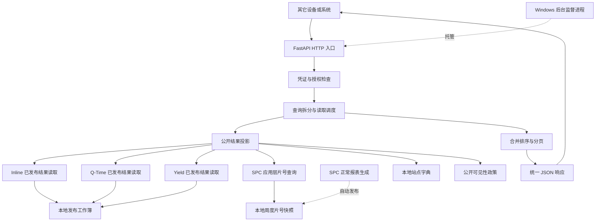

# 异常片／Lot API 程序介绍

更新日期：2026-11-11。说明当前实现的功能、架构和处理流程，适用 API 1.4.0。

部署操作见 [服务部署说明](guide-sheet-anomaly-api.md)，参数、字段及实测步骤见 [调用说明](api-caller-guide-2026-11-03.md)。架构决定见 [ADR-0037](../../../../docs/ADR/0037-published-anomaly-api.md)。

## 1. 程序负责什么

程序把各报表已经发布的异常结果，整理成统一的 HTTP 查询入口。其它系统取得调用凭证后，可以按产品、分类、厂别、日期、站点、层别、参数及对象编号查询异常明细。

配套的 [Python 调用程序](../../../../tools/fetch_sheet_anomalies.py) 是独立客户端，可在本机或其它设备运行；它通过 HTTP 取数、预览和导出，不直接读取业务文件或数据库。使用 `uv run --no-sync python tools/fetch_sheet_anomalies.py` 打开图形窗口，默认不分页，填写每页行数后自动完整取页；其它程序也可导入其中的调用函数。

它支持 SPC、CTQ、AOI_TT、AOI_RS 的 OOS／OOC，Yield、Q-Time 的 OOS，以及 SPC 的 CPK／CPM 周度不达项。返回对象保留片、Lot 或能力周期项目的真实含义。其它趋势、IJP、备件、IQC、图像和原始量测点不属于接口范围。

## 2. 整体架构

图中的读取方向表示依赖关系。正式的异常计算、人工决定维护和结果发布由各报表流程负责，位于本次 HTTP 请求之外。API 不依赖浏览器中的 Streamlit 会话，也不在请求失败时启动报表生产或数据库补查。

### 2.1 各层的职责

| 层次 | 主要位置 | 职责 |
|---|---|---|
| HTTP 入口 | `api/main.py`、`api/schemas.py` | 定义路由、校验参数、鉴权、统一状态码和响应字段 |
| 查询协调 | `api/query.py`、`api/limits.py` | 解析授权与默认日期，拆分产品／分类查询，控制读取并发和部分失败 |
| 公开投影 | `api/service.py` | 读取公开可见的、已明确释放的记录，统一对象身份、字段和筛选 |
| 跨域装配 | `api/composition.py` | 连接各领域现有结果读取器、站点字典和公开政策 |
| 分页管理 | `api/pagination.py` | 保存有界公开快照、签发和校验下一页游标 |
| 配置与共享读取 | `api/settings.py`、`src/shared_kernel/infrastructure/` | 调用方配置、有界工作簿缓存、本地站点字典 |
| 领域能力 | Inline monitor、Indicator qtime、Yield 发布结果模块 | 各自维护发布协议、日期覆盖及来源有效性 |
| 能力项查询 | `src/inline_domain/application/monitor/capability_alert_query.py` | 只读已维护 CPK／CPM 台账，复用核心规则筛选完整 ISO 周，不维护汇总 |
| 能力项片号 | `src/inline_domain/application/spc/sheet_membership.py` | 从 SPC 制备点位发布完整周成员；HTTP 只读已发布成员，按业务键和目标周查询 |
| Windows 托管 | `tools/anomaly_api_service.py` | 注入凭证摘要、启动和监督单个 API worker、管理本次进程及日志 |
| 一键入口 | `start_anomaly_api.cmd`、`tools/start_anomaly_api.ps1` | 调用现有托管工具并核实服务就绪 |

`api/` 是独立的接口与装配层。各领域继续拥有自己的发布规则，公共查询入口不会把 Yield 或 Q-Time 的业务所有权转给 Inline。

## 3. 一次请求怎样处理

1. **检查身份。** 读取 `X-API-Key`，计算 SHA-256，与进程环境中的调用方摘要比较。缺少或无效返回 401。
2. **确定范围。** 检查显式请求是否获授权；未指定产品时，取启用产品与授权产品的交集。缺省日期取上海时区上一完整 ISO 周。
3. **拆分来源。** 按产品、分类、事件形成读取任务。省略事件时，SPC 查询 OOS／OOC／CPK／CPM，CTQ 和 AOI 查询 OOS／OOC，Yield 与 Q-Time 仅 OOS；七个产品、六个分类最多 84 个组合。显式事件只保留对应组合。整个读取在有限工作线程内处理，仍受原超时、容量和并发上限约束。
4. **读取与公开投影。** 先检查公开可见性，再读取已发布工作簿，应用明确释放决定，筛选授权厂别、对象、站点和参数，并补充本地站点层别信息。
5. **判断来源状态。** 单个来源失败时，该来源整批不加入结果，避免保留半批数据。其它来源继续；全部所选来源失败返回 503，部分失败在响应中明确标记。
6. **合并与分页。** 合并所有可用来源，按公开的发生时间及身份字段统一倒序；指定 `limit` 时从合并结果分页。
7. **返回响应。** 只输出字段白名单及安全元数据，提供请求编号便于排查，不把工作簿路径、内部控制列或异常堆栈返回给调用方。

公开政策要求隐藏的来源返回空结果，不通过文件故障、记录数或游标暴露其内部数据。来源读取失败与“没有可提供的异常”分别表达；HTTP 200 也可能是部分成功，调用方必须检查 `meta.complete`。

Inline 异常台账只在产生异常时创建对应产品工作表。因此，可读工作簿中没有产品工作表、已有表为空，或可读能力台账在所选完整周内没有记录，均为成功空结果，不加入 `failed_sources`，也不补建空表。AOI_RS 的空产品表无需 `chart_kind`；有记录时仍必须提供该列以区分 Sheet／Lot。文件缺失、读取错误、必要字段损坏，以及非空能力项目缺少匹配的片号快照，仍属于来源不可用。该空数据口径按用户 2026-11-11 的要求修订，替代此前将产品工作表缺失或能力台账缺周视为失败的处理。

## 4. 关键业务规则

| 规则 | 当前行为 |
|---|---|
| 时间 | 使用已有报表显示时间，不重复前推；日期包含首尾两天，历史受已发布内容与来源覆盖约束 |
| 默认事件 | `event_type` 省略时全选各分类支持的事件，显式填写时只查该事件；不要求非 SPC 调用方拥有 SPC 权限 |
| 释放决定 | 只有明确释放的有效记录进入公开结果；缺失证据不会默认释放 |
| 必要字段 | 记录身份、厂别、时间等必须完整；其它站点类来源还需真实站点和有效层别 |
| Q-Time 位置 | 发生站点和层别取起点 `f_step`，对象为 Lot |
| Yield 位置 | 厂别取发布结果，站点及层别固定为 null；时间保留入库日期精度 |
| Yield 厂别 | 在正常发布时根据 global.yaml 的 Defect Group 映射产生，HTTP 不计算或回写 |
| 来源有效性 | 各领域继续验证自己的发布和健康协议；API 缓存不会延长来源有效期 |
| 行数 | 每行是异常明细，同片多个站点／参数可出现多行；返回行数不是去重片数 |
| 能力项目 | `event_type=CPK/CPM`，仅 SPC；对象类型为 `capability`，保留六项必要字段并增加指标值、下限及统计周信息 |
| 能力周期 | 默认上一完整周；显式日期仅选完整包含且已经结束的 ISO 周。发生时间为统计截止日期，原 Sheet 数据跨度继续用于门槛判断 |

字典同步、释放决定维护及结果初始化都通过独立操作命令或原报表完成，具体步骤由部署说明维护。站点字典的 `--initialize` 在探查数据库视图和底层扫描规模后，带超时与条数上限读取完整字典，保存站点、描述及派生层别；`--step` 用于定向刷新，`--template-only` 才是离线空模板。源描述无法形成层别的站点保留并列为待维护，API 仍拒绝输出命中它的缺字段记录。请求侧不能指定文件路径、强制刷新、修改授权或绕过公开政策。

能力查询使用 CPK 产品同名工作表和 CPM 的 `<产品>_cpm` 工作表，复用 `normalize_latest_cpk` 和完整记录选择函数。严格 `<1.33`、明确 False、实际数据跨度和周期日期排除共同决定是否返回；不可计算值不会当成零。已发布能力消费不额外套用单片 PPA 排除。CPK／CPM 分别检查矩阵公开开关，缺少政策时保持不可用，HTTP 不自动创建配置。

能力记录由独立模型验证，指标值必须有限。旧片／Lot JSON 仍为 11 字段，能力记录为 17 字段；CSV 统一 17 列，普通记录的能力列为空。片／Lot 编号是字符串，能力项编号是全部 Sheet ID 的非空数组。数组去重、按文本升序且保留前导零；`entity_id` 按成员匹配，命中后返回整个项目名单。公开业务组合键负责项目排序，分页指纹覆盖完整名单，因此数值、片号或政策变化会使旧快照失效。

成员来源复用 SPC 应用层 By Sheet 点位，不从单片超规台账反推。正常报表在缓存外从原生点位 DataFrame 发布周度 JSON 快照，存于 `data/inline_domain/spc/sheet_membership/`；独立同步命令使用同一报表入口初始化。完整周按 `[周一, 下一周一)` 截取，保留其它历史周；片号按产品、厂别、站点、参数隔离。快照记录完整日期覆盖、策略签名及对应指标／真实跨度锚点，HTTP 验证后读取。资料缺失或不匹配时来源不可用，不启动生产补齐，不返回成功的空编号。

完整覆盖依据随同批点位携带的源快照证明：在原始快照事务锁内捕获真实覆盖与文件代际，经过显示时间前推，再随制备、特征及报表原生缓存传递。发布前再次核对当前来源，当前文件不能给旧缓存扩大覆盖范围。回退资料只覆盖半周时不会发布完整周；完整覆盖但本周变为空时发布空代，使旧名单失效。

`命中边界` 的 LOWER、NULL、空值和缺省统一为 `spec`；明确的规格／控制边界原值保留。CPK／CPM 的 `spec` 表示指标低于达标下限。

## 5. 缓存、分页与容量

工作簿缓存减少重复解析，公开快照支持连续分页。两者都保存在 API 进程中，当前按单 worker 部署；多个 worker 不共享这些状态。

| 项目 | 当前默认限制／行为 |
|---|---|
| 调用频率 | 每调用系统每分钟 60 次；来源地址另有总频率限制 |
| 读取并发 | 最多 2 个读取任务占用槽位，整个汇总读取等待上限 90 秒；便携客户端每次 HTTP 请求默认等待 120 秒 |
| 工作簿缓存 | 最多 16 项，缓存总量和单文件均有 64 MiB 上限；单次工作簿读取的所有工作表合计最多 20 万行 |
| 公开快照 | 最多 64 份，公开结果及快照存储受 16 MiB 限制 |
| 每页行数 | 显式 `limit` 为 1～500；省略时不按行数截断，仍受容量和超时限制 |
| 游标 | 默认有效期 300 秒，绑定身份、授权、筛选、结果和失败来源状态 |

分页仍要形成完整公开结果，不能绕过总容量限制。容量不足明确报错，不静默截断。结果变化、快照淘汰、过期或进程重启都可能要求从第一页重取。

读取 Excel 属于同步工作。HTTP 超时不会强制结束正在执行的 Office COM 调用，该任务仍占用有限槽位；程序不会为它无限补充替代线程。正式账号的企业保护文件可读性需另行验证。

只有检测到明确的工作簿版本变化时，查询协调会完整重读该来源一次，并重新检查公开政策；不重试普通缺资料或格式错误。两次读取共用原请求的等待期限，缓存仍验证实际版本，不返回旧版本兜底。持续变化会继续标记来源不可用。

## 6. 托管与安全边界

Windows 托管包含一个监督进程和单个 Uvicorn worker。worker 异常退出后，监督进程按退避规则重启；托管工具保存 PID 与创建时间，停止时核对自己拥有的进程。主机休眠或监督进程本身退出不能依靠这项机制保证服务在线。

一键脚本仅请求启动及检查就绪，缺少凭证时引导首次设置，已有服务异常时报告失败，不自动停止或重启。日志、状态和启动意图位于 `output/logs/anomaly-api/`；原始密钥不写入这些文件。

接口关闭默认访问日志，不把完整请求头、内部路径和控制信息输出给调用方。每个响应携带 `X-Request-ID`，并设置禁止缓存等响应头。当前内网 HTTP 入口没有传输加密，HTTPS 接入和长期无人值守运行由运维按部署要求安排。

API Key 是本项目选择的认证方式，用于绑定调用方、数据授权和独立限流，并非 HTTP 本身的必需组件。当前保留必填校验；查询程序从 `API_KEY`／`VIVO_API_KEY` 进程环境自动读取或使用窗口手动输入，不使无密钥请求变成匿名成功，不把真实密钥写入代码、导出或默认配置。客户端及上述启动命令不会自动加载项目 `.env`。

## 7. 代码入口与验证

| 目的 | 入口 |
|---|---|
| 查看接口和错误处理 | [main.py](../../../../api/main.py)、[schemas.py](../../../../api/schemas.py) |
| 查看查询与公开字段 | [query.py](../../../../api/query.py)、[service.py](../../../../api/service.py) |
| 查看跨领域装配 | [composition.py](../../../../api/composition.py) |
| 查看缓存和元数据 | [工作簿缓存](../../../../src/shared_kernel/infrastructure/api_workbook_cache.py)、[站点元数据](../../../../src/shared_kernel/infrastructure/api_alert_metadata.py) |
| 验证真实临时文件到 HTTP | [文件集成测试](../../../../tests/integration/test_anomaly_api_files.py) |
| 验证查询选项 | [HTTP 查询测试](../../../../tests/unit/api/test_query_options_http.py) |
| 验证一键启动入口 | [启动脚本测试](../../../../tests/unit/test_start_anomaly_api.py) |

单元与夹具验证不等于正式业务工作簿或其它设备已经验证。部署验收仍需健康检查、凭证调用、来源完整性和真实记录核对。

此前 1.3.0 的片号、分页及导出验证见 [片号优化验收记录](../../../../docs/dev_docs/generated/inline_domain/api/api-sheet-membership-delivery-2026-11-04.md)。当前正式版本为 1.4.0，省略事件时的真实结果已与 OOS／OOC／CPK／CPM 四次查询逐项对照；API／客户端回归 378 项、默认全选专项 10 项通过（有交集，不相加），见 [默认全选验收记录](../../../../docs/dev_docs/generated/inline_domain/api/api-default-events-delivery-2026-11-04.md)。此后按用户要求移除查询启动器及其专用测试，统一直接运行 Python 客户端。另一台设备的数据查询需在该设备运行调用程序验证。

## 8. 后续扩展方向（尚未实现）

以下是可考虑的后续扩展，需要先确认业务口径和来源数据，当前接口尚未返回：

| 信息 | 用途与前提 |
|---|---|
| 实测值、最小／最大值 | 判断异常程度；各来源量测口径不同，Lot未必有单一数值 |
| 规格／控制上下限、单位、超出幅度 | 解释超限方向与程度；需区分OOS／OOC并规范单位 |
| Yield缺陷分组 | 按Array_Line等分组汇总；现有发布已包含defect_group |
| 发布时间、数据覆盖范围 | 判断新鲜度；需统一各来源元数据，不能混同发生时间 |
| 稳定异常事件ID | 支持去重／增量同步；需定义跨来源稳定键与重新发布规则 |
| Lot／Sheet关联或Q-Time终点 | 支持追踪；需确认本地发布内容及业务含义 |

这些是未来建议，当前接口不返回以上新增信息。
