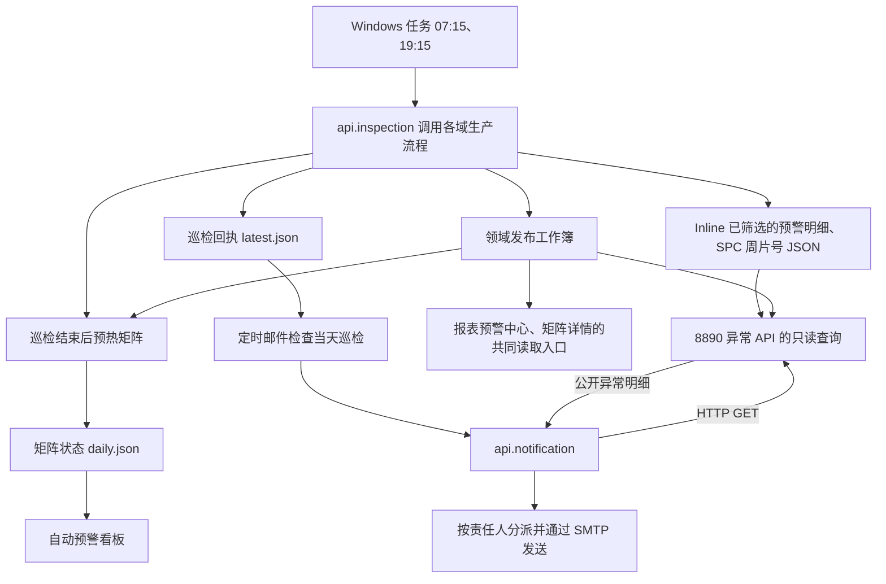

# 异常 API、巡检、邮件与报表页面的数据流

核对日期为 2026-11-26。本文说明 8890 的异常明细来源，以及报表可以复用的巡检结果。

## 1. 一次发布，多处读取

**定时邮件通过 HTTP 查询 API；API 通过各域只读 application 服务查询已经落盘的业务结果。** 巡检和 API 独立运行。即使当天无人打开页面，巡检也可以发布；收到 HTTP 请求只会读取和筛选结果。日常报表仍可维护各域原有的工作簿。Inline 对外明细和 SPC 周片号由巡检或显式维护发布。

巡检将 Inline 应用层筛选后的明细原子写入 `data/inline_domain/monitor/published_alerts/`。SPC 能力项目的完整片号单独按产品和周保存。API 读取明细及片号，按工作簿中的人工放行决定和调用方权限展示。Yield、Q-Time 已有独立的发布工作簿，API 直接读取其中覆盖查询日期的结果。巡检回执记录生产成败，矩阵快照保存看板状态。[巡检入口](../../../api/inspection/__main__.py) · [API 读取装配](../../../api/composition.py)

## 2. 从巡检到一封周报

| 阶段 | 入口及实际工作 |
|---|---|
| 生产 | 计划任务 `vivo-project Alert Inspection` 执行 `-m api.inspection`。按启用产品调用 SPC、CTQ、AOI、Yield、Q-Time、IJP、关键备件和 IQC 蒸镀的既有生产服务，按需读取源数据、计算并校验落盘结果。各模块分别记录成败，本轮生产后再预热矩阵。 |
| 定时邮件取数 | 周一 07:20、周二 11:00 的邮件任务进入 `api.notification.scheduled`，先核对当天、有效期内、覆盖应检范围的成功回执。巡检仍在运行就等待，通过后才调用 HTTP 客户端。直接查询 8890 的普通客户端无需经过邮件的回执检查。 |
| HTTP 查询 | 服务管理入口是 `tools/anomaly_api_service.py`，业务路由是 `GET /api/v1/sheet-anomalies`。邮件带凭证但不传查询参数，默认取上海时区上一完整 ISO 周、已启用且获授权的产品及所支持的事件，默认不分页。API 按产品、分类和事件逐项读取，再按厂别权限、公开策略与释放条件筛选、汇总。 |
| 返回与投递 | 正常无异常的来源贡献零行。部分来源不可用时返回 HTTP 200、`complete=false` 和 `failed_sources`；选中来源全部读取失败时返回 503。邮件对 HTTP 结果另行应用不完整结果策略，并按责任人合并投递；完整且零条时不发邮件。 |

巡检范围大于 HTTP 范围。API 目前支持 SPC 的 OOS、OOC、CPK、CPM，CTQ、AOI_TT、AOI_RS 的 OOS、OOC，以及 Yield 的 Lot OOS 和 Q-Time 的 OOS。IJP、备件、IQC 蒸镀、AOI 趋势和 Yield 趋势虽由巡检生产，零参数邮件也不会从此接口取到这些项目。[事件范围与聚合](../../../api/query.py) · [HTTP 路由](../../../api/main.py) · [邮件取数](../../../api/notification/infrastructure.py) · [定时邮件门禁](../../../api/notification/scheduled.py) · [邮件规则](notification/rules-alert-notification.md)

## 3. 12 小时具体约束什么

| 对象 | 写入与复用 | 有效性 |
|---|---|---|
| 领域发布结果 | 巡检或显式维护发布 Inline 对外明细及片号。Yield、Q-Time 复用各自发布工作簿。 | 业务规则由生产方执行。HTTP 按产品、范围和周身份索引，保留发布覆盖、数据结构、公开权限及人工放行检查。 |
| 自动预警矩阵状态 | 巡检预热写入 `daily.json`，自动预警看板复用命中的单元格。 | 检查参考日、全局 TTL、报表截止策略和单元格来源签名；未命中时可从发布文件读取。 |
| API 工作簿解析与分页 | API 进程复用同一版本工作簿的解析结果；需要翻页时另存公开结果快照。 | 解析缓存按路径、修改时间及大小识别版本，受容量限制。分页快照默认 **300 秒**，服务重启后旧游标失效。二者均由 API 进程自行建立。 |
| 页面预警选择缓存 | 报表和矩阵在同一 Streamlit 进程中可复用 `read_alert_result()` 的筛选结果。 | 键包含指标、产品、参考日、选择范围和来源签名等，TTL 来自全局配置。其他 Streamlit 进程和 8890 各自维护内存缓存。 |

**本机巡检每天 07:15 和 19:15 启动。** 12 小时是两次计划运行的间隔。8890 在查询范围内继续提供上次成功发布的结果。规则调整由下次成功发布体现。巡检失败的模块、产品和错误码可在 `output/logs/alert_inspection/latest.json` 查看。矩阵和定时邮件有各自的时效检查。[巡检调度说明](architecture-automatic-inspection.md)

## 4. 各页面实际复用什么

下表覆盖核对时 `app/pages/` 下的全部 16 个入口。判断复用要看页面上的具体区域。同一页可以先通过领域 application 计算报表，再从发布工作簿读回预警。页面与 API 共享文件也可能展示不同数量，因为授权范围、日期窗口、公开条件和展示粒度各有约束。[页面入口](../../../app/pages/) · [报表与矩阵共同读取入口](../../../app/sections/shared/alert_results.py)

| 页面 | 巡检产物的复用位置 | 其余数据从哪里来 |
|---|---|---|
| SPC、CTQ、AOI_TT、AOI_RS 监控报表（4 页） | 单片 OOS 预警读各域发布工作簿。SPC 还读 CPK、CPM 预警，两个 AOI 页面还读已发布趋势评估。 | 点位、报表图表和导出使用各域报表流程、测量数据及其快照。8890 另读周片号 JSON 返回完整 Sheet ID，普通 SPC 页面直接复用自身报表的点位。 |
| 入库不良率分析看板 | 周度 Lot 超规和 Yield 趋势预警中心读取已发布结果。此页也是生产方，可通过 `generate_yield_alert_publications()` 更新发布。 | 不良率分析、Mapping、图表与按需详情走 Yield 报表流程。 |
| 入库不良率 ByLot、BySheet 明细表（2 页） | 两张明细表直接调用 `YieldAnalysisService.get_lot_defect_rates()` 或 `get_sheet_defect_rates()`。 | 可复用 Yield 源快照与报表缓存；页面需要完整不良率明细，单靠超规 Lot 列表无法生成。 |
| Q_Time、IJP 溢流、关键备件、IQC 蒸镀材料报表（4 页） | 各自预警区域读取已发布的厂别告警、IJP 区域告警、备件寿命超限或 IQC／COA NG 结果。这里只有 Q-Time OOS 也属于 HTTP 接口范围。 | Q-Time 站点／单腔、IJP 明细、备件测量和 IQC 测点仍由各自报表服务加载。 |
| 自动预警看板 | 总览优先复用有效的矩阵状态快照；单元格未命中及预警详情按指标读取发布结果。 | 可选图像按需加载，矩阵缓存只覆盖状态。 |
| 历史预警看板 | OOS／OOC 历史查询可以复用同源台账；CPK／CPM 达标率使用各自监控服务与周期汇总。 | 页面按所选范围生成历史明细、汇总和趋势，另有 AOI_RS、Yield 等独立板块。 |
| 寿命测试报表、密集点测试报表（2 页） | 两者均走独立数据链。寿命测试与“关键备件寿命超限”是不同业务。 | 前者读 IQC 寿命测量，后者读配置的密集点测试工作簿。 |
| 专项资料-台账周报 | 直接访问已配置的资料目录。 | 页面提供文件预览、下载和维护。 |

例如，**IJP 有巡检、有页面预警，但不在 8890 的返回范围内**。反过来，Yield 分析看板的 Lot 预警与 API 可以读同一份发布工作簿，而 ByLot 明细页需要读取全部符合报表条件的 Lot。判断两处数据是否应一致，应先对齐业务对象、筛选范围和读取入口。[IJP 预警中心](../../../app/sections/indicator_domain/ijp/alert_center.py) · [Yield 预警中心](../../../app/sections/yield_domain/published_alert_center.py) · [ByLot 明细页](../../../app/pages/入库不良率ByLot明细表.py) · [历史预警看板](../../../app/pages/历史预警看板.py)
