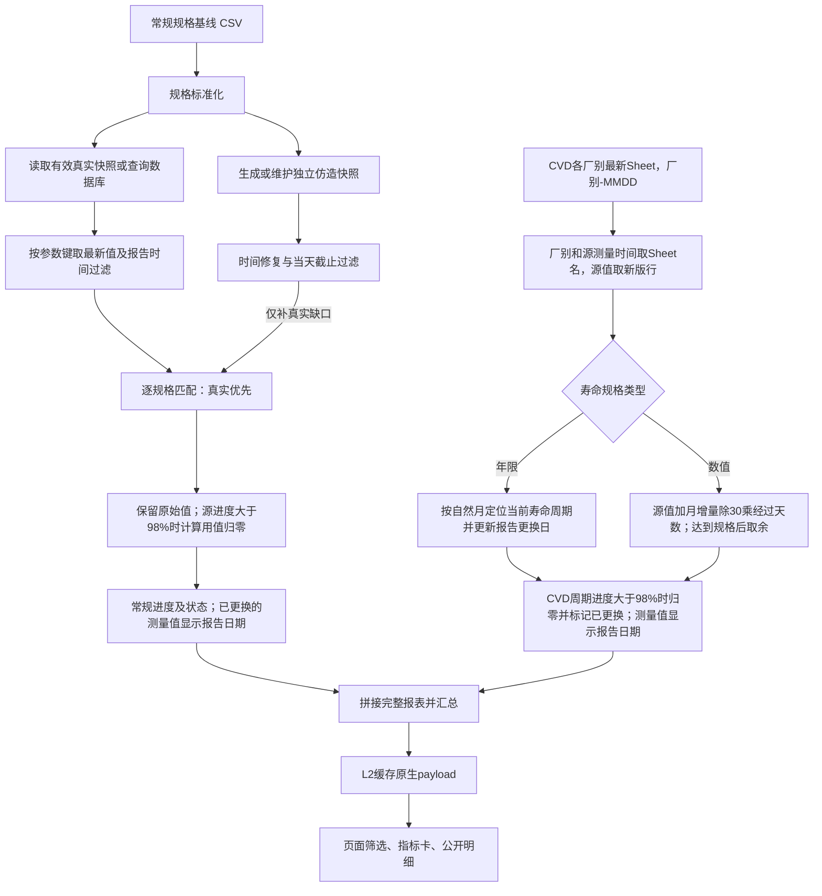

# 关键备件报表数据流与处理逻辑

> 核对日期：2026-10-26。依据 `app/pages/关键备件报表.py` 及其调用的服务、适配器、计算器和当前配置整理。本文描述现有实现；本次未查询生产数据库或重新统计维护工作簿行数。

## 1. 逻辑分类与执行关系

按数据来源与生成方式，当前报表有 **3 类主逻辑**。常规备件另有一层共用处理；CVD 内部有两种计算算法。

| 类型 | 输入 | 主要处理 | 进入最终报表的方式 |
|---|---|---|---|
| ① 数据读取 | 常规 CSV 规格基线、数据库真实测量或有效真实快照 | 规范化、按参数键取最新值、报告时间过滤、逐规格匹配 | 符合报告时间条件的真实记录优先 |
| ② 通用数据仿造 | 同一规格基线、独立仿造快照、当前时刻 | 首次生成、TTL 推进、数值增长、到期回绕、未来时间修复 | 对①未命中的规格补位 |
| ③ 特殊规则仿造（CVD） | CVD 工作簿各厂别的最新 Sheet、Sheet 更新日期、报告日期 | 从 Sheet 名解析厂别与日期；年限规格按新版更换日期计算日龄，数值规格从新版源值和更新日起按月增量推算 | 独立生成报表行，追加到常规结果 |

三类逻辑不是互斥的页面模式。一次载荷重新计算时，会读取真实数据、维护仿造数据，再计算 CVD。常规规格逐条择一：合格真实优先，缺失、陈旧或被截止规则排除时再尝试仿造；两个来源合流后，共同执行源进度 **>98% 时使用进度归零并标记“已更换”** 的规则，恰好98%不触发。CVD 在常规处理完成后追加，不参与来源竞争；其当前周期进度同样按 >98% 判定更换。常规备件和CVD在完成进度计算后，均将“已更换”行的最终“测量值”改为本次报告的更换日期（`YYYY-MM-DD`），不再显示0或旧更换日期。CVD达到完整寿命时进入新周期，数值取余，年限更新周期起点，再判断新周期状态。

因此，按来源计数是 **3 类**；若把合流后的转换也单独计数，可归纳为 **3 类主逻辑 + 1 类共用处理**。



## 2. 数据读取：规格与真实测量

### 2.1 常规规格基线

页面从全局资源配置解析 `critical_parts_baseline` 路径，通过 `PartsDataPort.load_baseline()` 加载。基线决定常规报表行集合，也是查询条件、快照签名、仿造身份和寿命计算的依据。

加载要求九列：厂别、备件类型、设备类型、膜层、制程、寿命规格、站点、机台号-腔室、参数名称。

1. 优先按配置编码读取 CSV，原始字段先按文本读取；寿命规格去掉非数字/小数字符后转数值，无法转换的值为空；删除整行均为空的记录并重建索引。
2. CSV 缺失时，通过 Windows Excel COM 读取配置指定的原始工作簿及 Sheet；从第二行开始，把换行分隔的站点和机台分别拆开，做笛卡尔展开，生成标准九列 CSV。
3. CSV 读取发生 `UnicodeDecodeError` 且文件头为企业加密标记 `00 00 00 00` 时，通过 Excel COM 读取可见值，校验表头和非空数据后原子替换为标准 CSV；无对应标记或校验失败时直接报错。

两种 COM 路径属于输入重建/规范化，不是测量值仿造，依赖本机 Excel 和 `pywin32`；不是每次页面访问都会执行。

### 2.2 数据库查询与真实快照

真实测量来自 `equipment.query.source_table`，当前为 `eda.ARRAY_PDS_RESULT_T`。

- 从基线提取去重的站点、机台/腔室和非空参数 `LIKE` 模式，构造参数化 `IN` / `LIKE` 查询；当前回溯窗口为 90 天。
- 读取 `step_id`、`sub_equip_id`、`param_name`、`value`、`glass_start_time`。站点和机台分别形成查询集合，结果仍需逐规格匹配完整约束。
- 列名转小写，测量值转数值并排除无效值，测量时间转时间类型。
- 按 `(step_id, sub_equip_id, param_name)` 只保留最新测量，再保存快照。因此当前快照是当前值集合，不是完整的 90 天历史序列。

真实快照有效时直接读，不查库；缺失或过期时重新查询，有结果才覆盖。读取旧版快照也按键压缩，必要时重写文件，但保留原 `mtime`，不延长 TTL。

数据库不可用或查询异常时，真实源返回空 DataFrame；空结果不覆盖磁盘旧文件，也不会在本次调用中回读过期快照。L2 若仍有效可提供上次视图；重新计算时由仿造分支补位。

### 2.3 报告时间过滤与真实优先资格

`load_report_part_life_snapshots()` 在快照输出边界执行：

1. 服务计算 `as_of`，取报告日结束时刻与当前时刻的较早者。
2. 真实记录仅保留 `[as_of - measurement_max_age_days, as_of]`，含端点；当前为近 3 天。陈旧、未来或无法解析时间的记录不参与真实优先匹配。
3. 真实和仿造输出都应用服务器当天截止时间，当前为 `12:00:00`（含）；历史日不额外截到中午。
4. 该报表直接使用快照时间，不应用全局 `data_forward.offset_days`，避免当前时钟生成的仿造数据再次被前推到未来。

近 3 天过滤只作用于真实源报告视图，不裁剪原始快照；仿造源不调用该过滤器，时间由自身维护控制。CVD 不经过该快照输出链路。

## 3. 通用数据仿造：生成、推进与补位

### 3.1 首次生成

每次进入快照层都会调用 `ensure_fabricated_snapshot_file()`。当前规格签名没有仿造文件时，自动生成并原子写入；生成覆盖可监控规格，使用时只取真实缺口对应记录。

- 可监控条件：寿命规格为有限正数，站点、机台/腔室非空。
- 每个唯一 `(站点, 机台/腔室, 已解析参数名)` 生成一条记录；同键不同寿命规格报错。
- 非空参数模式物化为满足 `LIKE` 的参数名。目前支持 `TRGTLIFE`、`MASKLIFE`、`PRE_SPRT_KWH` 对应模式，依赖机台中的 PM 编号；不支持的模式报错。
- 空参数用归一化规格身份生成带 `__FABRICATED_PART__` 前缀的稳定内部键，以便精确回配，不在前端展示。
- 初值为规格的 0%～100%，初始时间位于基准时刻前 2 天内。比例和时间偏移由业务键及配置种子稳定哈希产生，不使用运行时随机抽样；相同输入可复现。

仿造与真实快照都是五列：`step_id`、`sub_equip_id`、`param_name`、`value`、`glass_start_time`，以不同文件名前缀隔离，不互相覆盖。

### 3.2 TTL 推进与回绕

已有文件通过 `update_fabricated_snapshot_file()` 维护；当前 TTL 和时间推进步长均为全局配置的 **12 小时**。

1. 按文件 `mtime` 计算年龄。未满 TTL 时跳过数值推进；发现未来测量时间时仍整体回移，使最新时间不晚于本次 `now`。
2. 过期时按已经跨过的完整 TTL 周期数补齐；手工 `--force` 只推进一个周期。
3. 推进前校验五列、非空数据、唯一键、合法数值/时间和当前规格映射。
4. 每周期测量时间增加 `snapshot_ttl_hours`；数值增量为 `寿命规格 × update_increment_ratio × variation`。
5. 当前 `update_increment_ratio=0.15`，稳定变化因子 `variation` 位于 `[0.95, 1.05)`，每周期增加规格的约 14.25%～15.75%。代码沿用“daily”名称，实际步长不固定为一天。
6. 候选值 `>= 寿命规格` 时先取余保留溢出量，再限制在配置的 0%～30% 重置区间。
7. 推进后若最新时间超过 `now`，整体回移时间列；保持键集合、行数不变，原子写回同一文件。

复制、恢复或调整文件时间会影响 TTL 判断。报告进度归零及更换日期展示不写回仿造快照；快照继续按自己的增长、回绕机制维护。

自动维护可补建文件；手工生成默认拒绝覆盖已有文件，手工更新在文件缺失时直接报错，不退化为首次生成。

### 3.3 逐规格来源选择

`build_and_match_all()` 分别建立真实与仿造的 `(step_id, sub_equip_id)` 索引：

1. 先匹配经过报告时间过滤的真实记录。非空参数按 `LIKE` 等价语义匹配，`%` 表示任意序列，`_` 表示单字符，匹配不区分大小写。
2. 空参数只精确匹配稳定内部键，不把同站点/机台的任意真实参数当作命中。
3. 同一来源命中多条时取最新测量时间；时间均无效时取第一条。
4. 真实未命中才查仿造；两个来源均未命中仍保留规格行，测量值、时间和匹配参数名为空。

两个来源不先拼接后按最新时间竞争。较新仿造不能覆盖已命中的合格真实记录；陈旧真实记录会失去优先资格。

## 4. 特殊规则仿造：CVD 独立计算

### 4.1 工作簿读取

页面始终传入配置的 CVD 路径及报告日期。`load_cvd_parts()` 解析 `{厂别}-{MMDD}` Sheet 名，每个厂别选取最新版本，扫描定位字段表头；通常每个厂别只维护一个 Sheet，多版本选择是兜底。

- 兼容名称首尾空格，例如实际 `OLED-1012 `；厂别去空格并统一大写，支持 `OLED`、`ARRAY` 等厂别，覆盖行内旧厂别。
- MMDD 推定为不晚于报告日的最近一次有效月日。例如报告日 `2026-10-13` 时 `1012` 表示 `2026-10-12`；报告日 `2027-01-01` 时 `1231` 表示 `2026-12-31`。`0229` 回溯到最近有效闰年。该格式不携带年份，不能区分间隔整年的同月日版本。
- 同厂别多个版本时选最新推定日期，合并不同厂别结果，不叠加历史版本。活动版本的厂别/日期重复、Sheet 名非法或日期非法时明确报错。
- 源“测量时间”统一设为 Sheet 更新日期，覆盖行内旧值；源“测量值”和月增量从该版本的行读取。厂别和测量时间列可从表内省略，其余必需字段仍须存在。
- 最新版本表头/数据无效时不退回旧版本；格式不符合约定的 Sheet 不会被静默忽略。

规范化后的源字段为：

厂别、备件类型、设备类型、膜层、制程、寿命规格、站点、机台号、测量值、进度、测量时间。

普通 XLSX 直接读取；企业加密文件先复制到 `output/decrypted_files/` 的本次临时目录，再通过 `fr_file_decryption` 的 `excel-values` 策略读取临时源、生成值副本。Excel COM 不直接打开维护原文件，也不执行原文件保存；临时源和值副本读取后一起清理。企业加密层可能切换可读取的加密/明文视图，不能仅凭原始读取字节变化判断工作簿内容被改写。值副本可能丢失日期格式，Core 按年限规格还原 Excel 数值日期。

源“进度”在数值分支表示**月增量**，不是输出“使用进度”的百分比；年限分支不使用它。

### 4.2 年限规则：按自然月回绕，更新报告中的更换日期

寿命规格匹配正数（可含小数）加“年”且可精确换算为整数月时：

```text
源更换日 = 最新版本行中的源测量值解释为日期
额定月数 = 额定年数 × 12
周期更换日 = 源更换日 + k × 额定月数个自然月
周期到期日 = 源更换日 + (k + 1) × 额定月数个自然月
其中k为使周期更换日不晚于报告日的最大非负周期数；源更换日在未来时k=0
已使用天数 = max(报告日 - 周期更换日, 0)
周期进度 = 已使用天数 / (周期到期日 - 周期更换日) × 100%
周期进度 >98%：输出测量值=本次报告更换日期，使用进度=0%，状态=已更换
其余：输出测量值=周期更换日，输出周期进度，按普通预警阈值判定状态
两类输出日期均为 YYYY-MM-DD
```

以自然日和日历到期日计算，支持闰年和月末；报告日早于源更换日时进度为 0。`1.5年` 对应18个自然月，`0.5年` 对应6个自然月，不按固定365天折算。无法精确对应整数月的年限（例如 `1.01年`）明确报错，不静默近似。

2026-10-21确认的新规则：达到完整日历寿命时开始新周期，不写回工作簿；一次跨越多个周期时直接定位当前周期。各周期都以源更换日为日历锚点，例如2024-02-29的一年寿命到2025-02-28进入新周期，到2028-02-29仍回到原周年日，避免逐轮加月导致永久丢失闰日或月末。

超过98%但尚未到期时，进度归零并显示“已更换”，“测量值”必须显示本次报告的更换日期，而不是旧周期起点。例如源日期2025-04-26、2025-04-24、2025-04-22，规格1.5年，报告日2026-10-21时，三行均显示测量值2026-10-21、进度0%、状态已更换。到期后按新周期计算，未再次命中更换时显示新周期起点及其日龄进度。

### 4.3 数值月增量规则：从源值重算

寿命规格为正数时：

```text
起点日 = Sheet 名解析出的更新日期（已写入源测量时间）
经过天数 = max(报告日 - 起点日, 0)
累计推算值 = 源测量值 + 源进度 / 30 × 经过天数
周期测量值 = 累计推算值（小于寿命规格时）；否则为累计推算值 % 寿命规格
周期进度 = 周期测量值 / 寿命规格 × 100%
周期进度 >98%：输出测量值=本次报告更换日期，使用进度=0%，状态=已更换
其余：输出周期测量值与周期进度，按普通预警阈值判定状态
```

源测量值、月增量及推算结果须为有限非负数；每次从新版源值重算，重复刷新不累加，不写回源表或 Parquet。源“测量时间”不再使用行内旧时间或全局固定基准日期。

CVD 数值达到或超过寿命规格时取余保留溢出量，支持跨越多个周期；回绕后仍按自身月增量÷30线性增长，不使用常规仿造的TTL、15%增量、稳定微扰或0%～30%重置区间。例：规格100、源值97、月增量30，则源更新后第1天为98（预警），第2天周期值99（报告测量值为第2天的报告日期、进度0%、已更换），第3天累计值100（回绕0、正常），第4天为1（正常）。

例如，报告日为 `2026-10-13`，`OLED-1012` 中源值为 2800、月增量为 352，则结果为 `2800 + 352 / 30 × 1`；更换为新版 Sheet 后，从新版值和新版日期重新计数，不延续上一版本已计算值。年限备件则使用新版行内更换日期，Sheet 更新日期不会替代它。

Core 仍为直接注入的旧格式源数据保留 `baseline_date` 空时间回退，但页面读取新版 Sheet 时已提供明确时间，不依赖该回退；应用服务不再把固定基准日期配置作为加载前置条件。

### 4.4 与常规处理的边界

| 项目 | 常规备件（真实/通用仿造） | CVD |
|---|---|---|
| 行集合 | 常规 CSV 基线 | 工作簿各厂别最新版本 Sheet |
| 来源选择 | 新鲜真实优先，仿造补缺 | 独立追加，不参与竞争 |
| 测量值 | 未更换时为匹配后的累计数值；已更换时为本次报告更换日期 | 未更换时为周期更换日期或周期数值；已更换时为本次报告更换日期 |
| 进度 >98% | 进度归零，标记“已更换”，测量值显示本次报告更换日期 | 当前周期进度归零并标记“已更换”，数值及年限规格的测量值均显示本次报告更换日期 |
| 数值回绕 | 通用仿造快照自身推进时取余并限制0%～30%；真实值不改写 | 先按自身月增量算累计值，达到规格后取余保留溢出量，再判当前周期状态 |
| 年限回绕 | 不适用 | 达到完整自然月寿命后更新报告更换日期，按新周期日龄增长 |
| 回绕后增量 | 规格×15%×稳定微扰，每个TTL推进 | 数值用源月增量÷30；年限按自然日增长，各自独立 |
| 状态 | 更换标记优先，否则 >100% 超规、>90% 预警 | 当前周期 >98% 标记更换，否则按普通预警阈值 |
| 测量时间 | 来源记录时间 | 报告日期，不代表重新采集时间 |
| 3 天过滤 / 当天截止 | 快照输出链路执行；3 天仅过滤真实源 | 不进入该链路 |

服务在常规计算完成后拼接 CVD 行再汇总。源“进度”不进入 CVD 输出；“机台号”映射为“机台号-腔室”，站点统一为文本。

历史规模供接入背景参考：2026-09-22 文档记录常规基线 1,781 行，CVD 215 行、7 种备件，其中年限规则 188 行、数值 Mask 规则 27 行。代码按规格类型分支，不硬编码这些数量；当前工作簿规模见下段核验。

2026-10-13 新版工作簿核验：`OLED-1012 ` 为 215 行，`ARRAY-1012` 为 328 行，合计 543 行。ARRAY 行的寿命规格均为 `1.5年`，源“测量值”为 Excel 更换日期序号，月增量为空，按 18 个自然月的年限分支处理；无需补填月增量。当前常规基线没有 CVD 行，未发现与该工作簿重复的监控项。

## 5. 合流后的常规规则与页面输出

### 5.1 保留原始值，执行98%更换规则

常规匹配结果依次经过 `apply_lifetime_replacement()`、`batch_calculate_progress_and_status()`、`apply_replacement_measurement_dates()`：

1. 复制匹配值到内部“原始测量值”，按原值严格大于规格记录“是否超规”。
2. 有限正规格且源进度 **>98%** 时，将用于进度计算的数值设为0，“数据修饰”设为“寿命到期更换”；源值、源时间和磁盘快照不改写。恰好98%不触发。
3. 使用数值计算百分比，无效值填0；更换标记优先产生“已更换”。
4. 其余按 >100% 超规、>90% 预警、其余正常判定。
5. 计算完成后，仅将“已更换”行的最终“测量值”改为本次报告更换日期，保留已算出的0%进度和状态；没有更换的行保持原值。CVD在其Core报表构造末尾复用相同日期投影函数。混合日期与数值的列显式转为object，不再把日期参与数值除法。

旧超规修饰、按前值增长、98%展示截断的函数、分支和配置项均已移除。各行更换判定独立，不再分组、排序或依赖前一行。

| 常规规格为100，报告日2026-10-21 | 最终测量值 | 使用进度 | 状态 | 原始超规标记 |
|---|---|---|---|---|
| 原值 98 | 98 | 98% | 预警 | 否 |
| 原值 98.01 | 2026-10-21 | 0% | 已更换 | 否 |
| 原值 105 | 2026-10-21 | 0% | 已更换 | 是 |

“已更换”不是持久工单或只显示一次的事件：L2命中时保持缓存状态；重新计算后，只要参与判定的当前周期进度仍 >98%，仍会显示。常规真实值更新到阈值以内、通用仿造快照自行回绕，或CVD进入新寿命周期后，下一次实际重新计算才会清除该标记；单纯点击刷新不保证消失。CVD回绕发生在完整寿命，不能把98%进度归零当作回绕起点，否则会改变原有增量轨迹。

本次报告更换日期取 `as_of_date`；页面以服务器当前报告日传入，历史调用使用指定报告日，不使用源表中的旧日期，也不在Core直接读取系统时钟。它是报告判定日期，不是新增的持久更换记录；同日重复计算不变，跨日重新计算且仍为已更换时显示新报告日期。展示日期不写回工作簿或快照，不用作后续寿命、日龄或月增量的起算日期。

### 5.2 筛选、指标与公开明细

服务追加 CVD 后返回完整报表和汇总；页面按厂别、设备类型、备件类型多选筛选，再统计总数、超规、预警、正常卡片。

- 厂别候选项和公开表格统一为大写编码；厂别匹配忽略大小写及首尾空格，将常规源的 `Array` 与新版 CVD 的 `ARRAY` 归到同一筛选范围。服务源值保持原样，旧会话传入的 `Array` 仍可匹配；设备类型和备件类型保持既有匹配口径。
- 没有“已更换”独立卡片，故 `总备件数` 可大于 `超规 + 预警 + 正常`，差额为已更换行数。
- “最后更新”为完整合并数据的最大有效测量日期，筛选后不重算；CVD 时间为报告日，因此它可能体现计算日期，不一定是最新真实采集日期。
- `_prepare_parts_table()` 在传给 `st.dataframe` 前只选公开列。原始值、超规标记、修饰标记、匹配参数名、参数名称等内部字段不进入表格及原生导出。
- 混合日期/数值的“测量值”和混合年限/数值的“寿命规格”转为文本以兼容 Arrow；纯数值列保留数值类型。测量时间按日期展示，站点按文本展示。

### 5.3 自动超规预警与 Excel 快照

2026-10-26 用户确认：自动预警当前使用进度严格大于 100% 的备件，并在 `resources/equipment_domain/parts/` 保存本地 Excel 快照。

- 页面成功取得完整报表后，自动检查全部厂别、设备类型和备件类型，包括已追加的 CVD 行；无需额外查询操作，不受页面的手动筛选影响。备件预警反映当前状态，不是上一周历史统计。
- Core `build_parts_alerts()` 以最终报表“使用进度”为唯一判据，数值为百分数（110 表示 110%）。严格大于 100 且为有限数才触发，恰好 100、缺失和无效值不触发；非空报表缺少使用进度列时显式失败。预警项状态统一显示为“超规”，不使用内部“是否超规”或源测量值回推。
- 原有 >98% 更换与归零逻辑继续生效，因此当前正常生成的报表通常不会出现 >100% 项。零进度“已更换”不因内部原始超规标记产生预警；源快照和更换规则不变。
- “超规备件预警中心”有异常时自动展开并展示公开明细，进度按数值百分比显示完整的 >100% 值；正常、无监控数据、预警计算或快照写入失败使用独立业务提示。预警写入失败不影响已有普通报表展示；报表加载失败时不计算预警、不发布快照。
- Application `publish_parts_alerts()` 只依赖应用拥有的 `PartsAlertStore`；composition 注入 Infrastructure 的 `PartsAlertWorkbook`。复用已经加载的报表与既有 L2 缓存，预警不增加数据库读取；每次页面执行在缓存外重新判定并发布，确保刷新或配置路径更改后更新本地文件。
- 快照路径的唯一配置来源为 `config/global.yaml` → `resources.equipment_domain.files.parts_alerts`，默认 `resources/equipment_domain/parts/parts_alerts.xlsx`；第一次成功发布时自动创建，无需预置业务记录。
- `超规备件` sheet 保存最新完整超规清单，字段与公开明细一致；`__meta__` 保存报告日期、源最后更新日期、发布时间、超规条数和成功状态。它是最新结果快照，不是追加型历史台账，不作为取数失败时的当前数据回退。
- 成功的空结果清除旧预警；写入使用 OS 文件锁、内存 Excel 核验和同目录临时文件原子替换，失败保留原文件并清理本次临时文件，保留工作簿其他 sheet。快照、预警表和原生下载均不包含原始测量值、内部超规/修饰标记、参数名或数据来源说明。
- `tests/unit/test_parts_alerts.py` 覆盖阈值边界、无效值、内部字段剔除及发布失败；`tests/integration/test_parts_alert_workbook.py` 覆盖快照更新、空结果清除、其他 sheet 保留和原子替换失败；`tests/unit/app/pages/test_parts_page_alerts.py` 使用合成数据验证实际页面、完整范围、筛选独立性、普通模式字段边界与失败保留。

## 6. 配置、缓存与刷新

### 6.1 路径和运行参数

| 所有者 | 配置 / 对象 | 当前值或位置 |
|---|---|---|
| `config/global.yaml` | `resources.equipment_domain.files.critical_parts_baseline` | `resources/equipment_domain/parts/critical_parts_baseline.csv` |
| `config/global.yaml` | `resources.equipment_domain.files.baseline_source_excel` | `resources/equipment_domain/parts/供应商关键备件寿命管控清单-0604.xlsx` |
| `config/global.yaml` | `resources.equipment_domain.files.cvd_parts` | `resources/equipment_domain/parts/供应商关键备件寿命管控清单-CVD.xlsx` |
| `config/global.yaml` | `resources.equipment_domain.files.parts_alerts` | `resources/equipment_domain/parts/parts_alerts.xlsx` |
| `config/global.yaml` | `application.cache_ttl_hours` | 12；同时控制真实、仿造快照和页面 L2 TTL |
| `config/global.yaml` | `report_cutoff.latest_day_time` | `12:00:00`，含边界 |
| `config/domain/equipment_domain.yaml` | `equipment.snapshot.directory` | `data/equipment_domain/parts` |
| `config/domain/equipment_domain.yaml` | 查询、告警、仿造、旧格式 CVD 回退策略 | 90 天查询、3 天新鲜度、90/100 状态阈值、0.15 仿造增量；新版 CVD 起点来自 Sheet 日期 |
| `core/parts_calculator.py` | `REPLACEMENT_PROGRESS_THRESHOLD` | 98.0，常规备件与CVD共同使用；比较为严格大于 |

维护资源路径通过 `ConfigLoader.get_domain_resource_path()` 解析。原始 Excel 路径由全局资源注册注入 `baseline.source_excel_path`，不另设资源路径来源。

### 6.2 L1 与 L2

| 层级 | 身份 | 内容和行为 |
|---|---|---|
| L1 真实 | `part_life_snapshot_<signature>.parquet` | 数据库最新键记录；有效读取，失效查询 |
| L1 仿造 | `part_life_fabricated_<signature>.parquet` | 可监控键当前值；缺失生成，过期推进 |
| L2 页面 | `PartsReportService.fetch_report_payload()` 参数缓存键 | DataFrame、字典和原生标量；全局 12 小时 TTL，`max_entries=8` |

L1 的 `<signature>` 为完整规格 DataFrame（含行序和索引）的 12 位内容签名；两种快照共享签名，以前缀隔离。规格内容或顺序变化会定位到新文件。

L2 键包含基线路径、页面版本签名 `parts_report_replacement_dates_v7`、报告日期、基线文件签名、运行配置及截止策略签名、CVD 路径和文件签名。文件签名由绝对路径、修改时间和大小生成，区别于 L1 内容签名；数据库管理器和注入 port 不参与哈希。更新源值、重命名 Sheet 或替换工作簿后，文件签名变化即重新计算。此次版本签名升级使仍包含0或旧更换日期的L2载荷失效，不清理源快照。

`PartsReportViewModel` 在缓存外重建，避免热重载期间自定义类的 pickle 身份冲突。L2 命中时不再次维护仿造或重算 CVD；过期、失效、跨日或输入签名变化才重新进入完整链路。

### 6.3 刷新动作

| 动作 | 当前执行流程 |
|---|---|
| 刷新数据 | 重载基线，以 `force_refresh=True` 绕过 L1 TTL 查库；非空才覆盖真实快照；全部 handler 成功后页头调用 `perform_hard_reset()`，清理 L2、重载代码、重读配置 |
| 刷新缓存 | 清理页面 L2 和相关 session view state，重载代码、重读配置；本身不强制查库，下一次加载按 L1 TTL 判断 |

`safe_refresh_snapshots()` 自身只刷新真实 L1，页面回调成功后连带失效 L2；失败时不清 L2，保留当前缓存视图。下一次完整加载检查仿造 TTL 并重算 CVD；有效仿造文件不重复推进数值。普通浏览器刷新或 rerun 不等同于清除 L2。

## 7. 失败边界与保留工具

### 7.1 失败和缺数行为

| 场景 | 当前结果 |
|---|---|
| CSV 缺失 | 尝试从配置 Excel 重建 |
| 基线列缺失、输入规范化失败 | 报表加载失败 |
| 数据库异常、不可用或无结果 | 真实源为空；不覆盖旧文件、不回读过期文件，尝试仿造 |
| 真实时间不合格或被截止规则排除 | 不参与真实优先，尝试仿造 |
| 仿造文件缺失 | 自动生成独立快照 |
| 仿造结构/键/更新数据非法 | 相关校验失败时上抛，不自动重建损坏文件 |
| 两个常规来源均未命中 | 保留规格行，值和时间为空，进度按 0 处理 |
| CVD 文件缺失、字段不完整或规则输入非法 | 整次加载失败，不缓存仅含常规行的部分结果 |
| CVD Sheet 名/日期非法、活动厂别版本重复 | 整次加载失败，不使用旧日期或任意首个 Sheet |
| 手动真实刷新失败 | 保留 L2 当前视图 |

页面捕获整体加载异常，显示业务错误提示；技术原因写服务端日志。

### 7.2 趋势工具不属于当前页面链路

当前页面只调用普通明细表，没有调用单行选择表或 `parts_chart.py` 的趋势函数。保留工具 `generate_trend_data()`：

- 从配置目录枚举 `part_life_snapshot_*.parquet`，读取第一个真实文件，未按当前规格签名精确定位。
- 按厂别、膜层、备件类型对应规格，以及站点、机台、参数模式和时间窗口过滤，再按日取最大值。
- 添加规格线、预警线，复用常规原始超规保留和 >98% 更换函数；不使用仿造或 CVD 数据。

若后续接入，需考虑文件枚举选择、空参数与明细口径差异，以及真实快照仅保留最新键值、不能保证恢复完整历史趋势的限制。它不是当前页面底部已经展示的功能。

## 8. 实现与决策索引

| 职责 | 实现 |
|---|---|
| 页面入口与筛选后汇总 | [关键备件报表.py](../../../../app/pages/关键备件报表.py) |
| 编排、CVD 追加、L2 缓存 | [parts_service.py](../../../../src/equipment_domain/application/parts_service.py) |
| 出站适配与组装 | [report_data_adapter.py](../../../../src/equipment_domain/infrastructure/report_data_adapter.py)、[composition.py](../../../../src/equipment_domain/composition.py) |
| 基线、真实查询、快照、时间过滤 | [data_loader.py](../../../../src/equipment_domain/infrastructure/data_loader.py) |
| 仿造生成 / 维护 | [fake_data.py](../../../../src/equipment_domain/infrastructure/fake_data.py)、[fake_data_updater.py](../../../../src/equipment_domain/infrastructure/fake_data_updater.py) |
| 空参数身份 / 来源匹配 | [parts_identity.py](../../../../src/equipment_domain/core/parts_identity.py)、[parts_matcher.py](../../../../src/equipment_domain/core/parts_matcher.py) |
| 常规更换、进度、状态及通用更换日期投影 | [parts_calculator.py](../../../../src/equipment_domain/core/parts_calculator.py) |
| CVD 读取 / 特殊算法 | [cvd_parts_loader.py](../../../../src/equipment_domain/infrastructure/cvd_parts_loader.py)、[cvd_parts.py](../../../../src/equipment_domain/core/cvd_parts.py) |
| 公开投影 / 刷新回调 | [parts_dashboard.py](../../../../app/sections/equipment_domain/parts_dashboard.py)、[page_header.py](../../../../app/components/page_header.py) |
| 配置与运行策略 | [global.yaml](../../../../config/global.yaml)、[equipment_domain.yaml](../../../../config/domain/equipment_domain.yaml)、[config.py](../../../../src/equipment_domain/config.py) |
| 保留的趋势工具 | [parts_chart.py](../../../../app/charts/equipment_domain/parts_chart.py) |
| 运维生成 / 更新 | [fabricate_equipment_data.py](../../../../tools/fabricate_equipment_data.py)、[update_fabricated_equipment_data.py](../../../../tools/update_fabricated_equipment_data.py) |

来源隔离和优先级见 [ADR-0003](../../../../docs/ADR/0003-equipment-real-first-fabricated-fallback.md)，部分条款已被 [ADR-0010 自动维护](../../../../docs/ADR/0010-equipment-fabricated-snapshot-auto-maintenance.md) 和 [ADR-0011 真实新鲜度](../../../../docs/ADR/0011-equipment-measurement-freshness-fallback.md) 替代。ADR-0010 的 1 小时应用缓存、24 小时仿造 TTL 和按日推进是当时参数；当前 TTL、步长及增量以本文核对的配置和代码为准。
